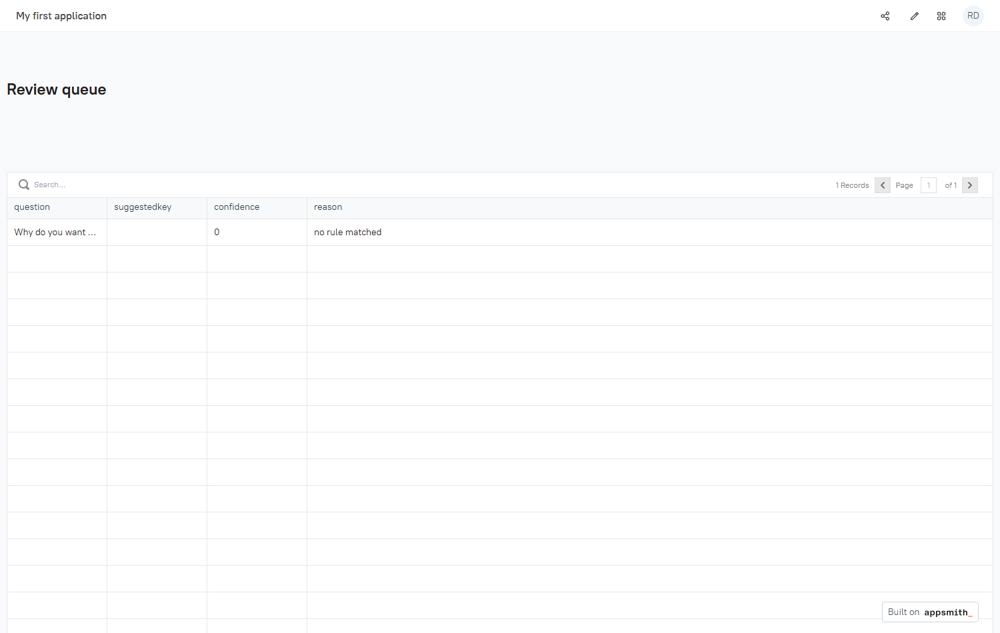
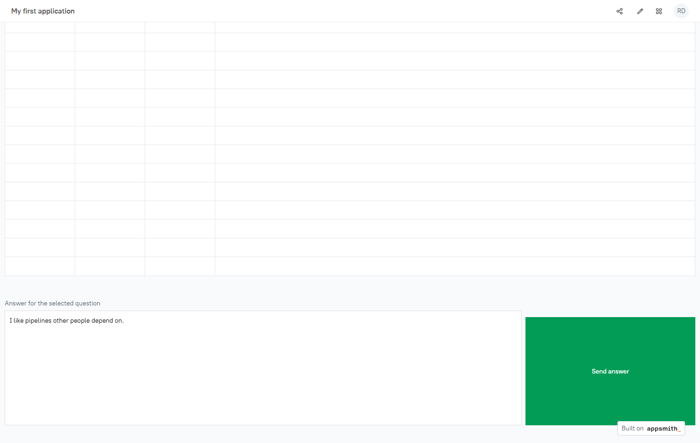

# An Appsmith app on the review queue

The hub's review queue is plain HTTP (`GET /api/jobs/review`, `POST /api/jobs/review/{id}/answer`, see [job-pipeline.md](job-pipeline.md)), so any internal tool can be the screen a person answers on. This is one: an Appsmith app with a table of the open questions, a text box and a Send answer button.

## What was built and what ran

- Appsmith Community Edition v2.7.0 in Docker (`appsmith/appsmith-ce`), one REST API datasource (the hub, with an operator API key in an `Authorization` header) and two queries: `ReviewQueue` (GET `/api/jobs/review`, runs on page load) and `AnswerTask` (POST `/api/jobs/review/{{Table1.selectedRow.id}}/answer`, body `{"answer": "{{AnswerInput.text}}"}`).
- A page with a table bound to the queue, a text area and a button whose click runs `AnswerTask` and then `ReviewQueue` again.
- Run in a real browser against a real hub with a real run waiting on a question (a stand-in application form, as in the rest of the pipeline): the published app showed the question, a click on its row selected it, the answer was typed and sent, Appsmith's server called the hub (`pending_left: 0`), the queue refreshed to empty, and the hub's own `GET /api/jobs/review` agreed. The run was started by `scripts/review_queue_demo_stack.py` against a scratch database.
- The app is exported as [appsmith-review-queue.app.json](appsmith-review-queue.app.json) with the API key and the host replaced by placeholders, and the exported file was imported back into the instance as a second app to check that it imports.

## Things that were not obvious

- **Appsmith 2.1 and later refuses a REST datasource on a loopback or private IPv6 address** ("Host not allowed"), and Docker's `host.docker.internal` resolves to a private IPv6 address on this machine, so the datasource points at the machine's LAN IPv4 address instead. Put the hub on a name or an address Appsmith may call.
- The Table widget is imported from a hand written page definition; Appsmith's table migration drops the last character of a column key it did not generate, so the table is left to build its own columns from `tableData`, and `tableData` maps the hub's field names to column names without underscores.
- The text input came out as a text area. It works the same.

## Limits

The app was driven through Appsmith's own REST API and a browser; it was not built by dragging widgets in the editor, so the layout is plain. Authentication to the hub is one shared API key in the datasource, which is fine for an internal tool on a private network and not for a screen shared with anyone outside the team. Appsmith was a local container, never a cloud account.
