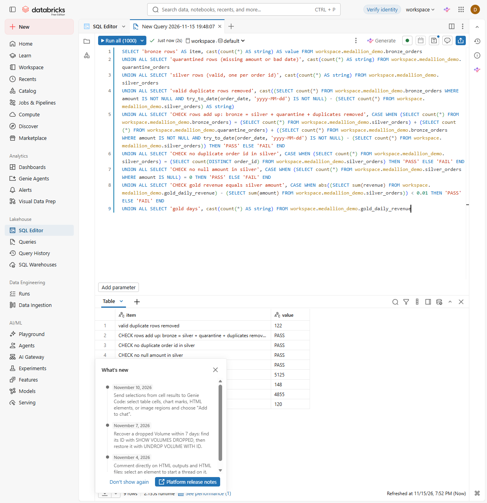

# Databricks Free Edition run

A medallion pipeline written as SQL and run on a Databricks Free Edition workspace (serverless starter warehouse, catalog `workspace`, schema `medallion_demo`) on 2026-11-15.

*The summary query after the six statements in [`medallion.sql`](medallion.sql) ran one at a time.*

## What it does

- **Bronze.** 5,125 generated orders: 5,000 in a first batch plus 125 of them repeated in a second batch, each row with its source file, ingest time and a row hash.
- **Quarantine.** 148 rows held back with a reason (a missing amount or a date that is not a date), never dropped.
- **Silver.** 4,855 valid rows, one per order id, deduplicated with `row_number`.
- **Gold.** 120 days of daily revenue, orders and customers.
- **Checks.** Four statements printed PASS: the rows add up (5,125 = 4,855 + 148 + 122 duplicates removed), no duplicate order id in silver, no null amount in silver, and gold revenue equals the silver amounts.

## What it was built and run against

Generated orders, one run, SQL on a serverless warehouse, Delta tables in Unity Catalog on the free workspace. It has no Lakeflow job, no PySpark notebook and no real source system. The local PySpark and Delta pipeline with a run log, quality flags and a runbook is in [`lakehouse/`](../../lakehouse).
