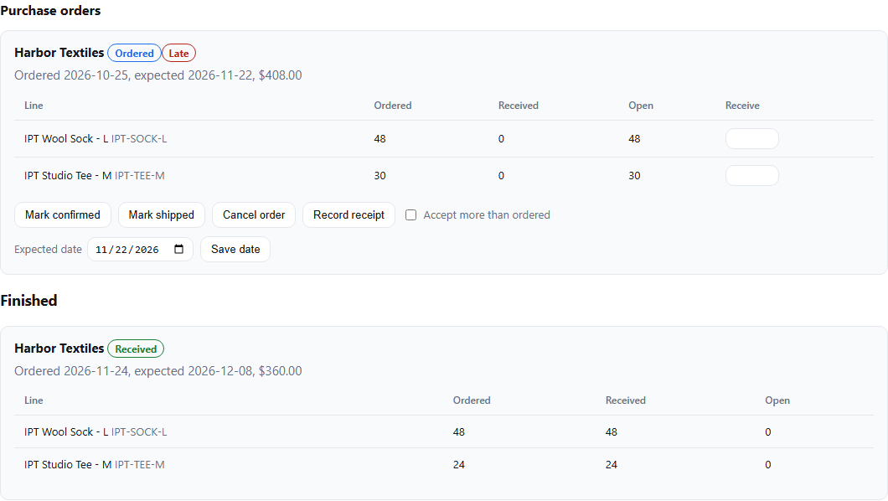
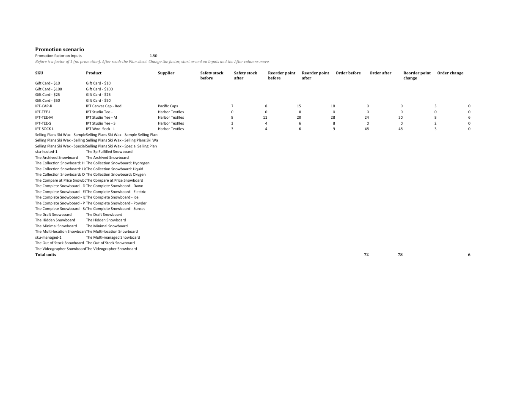

# Inventory planning

Reads the stock of every Shopify variant, keeps it as a dated snapshot, and works out from the stored stock and the stored order lines how fast each variant sells, how long its stock lasts, when to order, how much, and which products are best sellers, rising or slow. It then tracks what was ordered: a purchase order per supplier from the plan's draft, its status from draft to received, its expected date, what arrived on each line and a late alert. The code is `app/inventory/`; the tables are `migrations/020_inventory_planning.sql` and `migrations/021_purchase_orders.sql`; the page is `/inventory` in `web/`; the routes are `app/api/inventory.py`.

It was built and run against the owner's Shopify development store. A supplier, its lead time, a promotion and every purchase order are figures a person enters: the store holds none of them, and nothing here invents them. [The first recorded run](test-runs/2026-11-24-inventory-planning-dev-store.txt) says exactly what the store held and what was entered; [the second](test-runs/2026-11-24-inventory-orders-and-workbook.txt) covers the order tracking and the workbook.

## The loop

```
python scripts/inventory_plan.py sync                    read variants, stock and the last 120 days of orders; store today's snapshot
python scripts/inventory_plan.py supplier --name "Acme Goods" --lead-days 21 --lead-sd 4
python scripts/inventory_plan.py assign --variant TEE-1 --supplier "Acme Goods" --moq 50 --pack 12
python scripts/inventory_plan.py promo --from 2026-12-01 --to 2026-12-07 --factor 1.5 --by "ads team" [--variant TEE-1]
python scripts/inventory_plan.py plan                    work the plan out, store it, print it
python scripts/inventory_plan.py order-create --supplier "Acme Goods"      a draft order from the plan, with its lines
python scripts/inventory_plan.py order-move --order 1a2b3c4d --to ordered   place it; the expected date is the order date plus the lead time
python scripts/inventory_plan.py order-receive --order 1a2b3c4d --line TEE-1 --qty 25
python scripts/inventory_plan.py orders --open           the open orders, what is still to arrive, which are late
python scripts/inventory_plan.py workbook --out plan.xlsx  the plan as an Excel workbook with live formulas
python scripts/inventory_plan.py alerts --deliver        raise each shortage and each late order once, push the pending ones to a webhook
python scripts/inventory_plan.py digest --state s.json   the shortages and late orders still open, worded once (the hub's alert policy)
```

Run `sync` daily (a stock history only exists for the days a sync ran), then `plan`, then `alerts`. Every command runs as the request role with the tenant set, so row level security scopes it. The `/inventory` page reads the stored plan and never calls Shopify.

## What is read from Shopify

`app/inventory/reader.py` sends two queries through the existing `ShopifyConnector` transport, which paces itself from the cost bucket each response reports. It never sends a mutation. For each product variant it reads the names, SKU, whether stock is tracked, the unit cost when the shop holds one, and for each location the `available`, `on_hand`, `committed` and `incoming` quantities (scope `read_inventory`). For orders it reads each line's variant, the quantity still standing after order edits and the unit price after line discounts, on the day the platform attributes the order to (`processedAt`, UTC). A cancelled order is skipped.

Limits: a refund that leaves the goods with the customer is not netted from the units (only an order edit that removes a line is); revenue is before order-level discounts and excludes shipping and tax; an order older than 60 days needs the `read_all_orders` scope.

## Which days a variant was on sale

Shopify serves the current quantity and no daily history, so the history is accumulated: `inventory_snapshot` holds one row per variant per day, written by each sync (a second sync the same day corrects that row). Each day of a window is then one of three things:

| State | When |
|---|---|
| in stock | a unit sold that day (a sale proves stock, even when the last unit left zero), or the snapshot that day shows stock |
| out of stock | the snapshot that day shows none and nothing sold, or there is no snapshot and the nearest earlier snapshot shows none and no later one shows stock |
| unknown | every other day with no snapshot, which includes every day before the first sync ever ran |

An out of stock day is never counted. An unknown day is counted as on sale by default (no record of a stockout is not a stockout), or left out when the plan is run with the `exclude` policy. Each plan line says how many days it counted, how many were out of stock and how many were assumed, and `coverage` is the share of the window whose state was observed.

## The formulas

Daily velocity `d` is the units sold over the counted days divided by the number of counted days, so a variant out of stock for ten days of twenty eight is divided by eighteen. The variance of the daily units over the same days gives `sd` (sample variance) and the standard error `sd / sqrt(n)`. The recent window is the 28 complete days before the plan date; the prior window is the 28 before that.

- Days of cover = available / d (none when nothing sells).
- Safety stock = z * sqrt(L * sd^2 + d^2 * sdL^2), rounded up, where L is the supplier's lead time in days, sdL its standard deviation and z the normal quantile of the service level (95 percent by default, z = 1.645).
- Reorder point = d * L + safety stock, rounded up. A variant is on the reorder list when its stock position (available plus what is on order) is at or under it.
- Order quantity = d * (L + review days) + safety stock - stock position, rounded up, then raised to the supplier's minimum order quantity and to whole packs. The review days (14 by default) are the cover the order buys beyond the lead time.

A hand worked case, which the tests pin: a variant sells 2 a day with a standard deviation of 1, the lead time is 9 days, there are 10 on the shelf, the minimum order is 50 and packs are 12. Safety stock is 1.645 * sqrt(9 * 1) = 4.93, held as 5. The reorder point is 2 * 9 + 4.93 = 22.93, held as 23. Cover is 10 / 2 = 5 days, under the 9 day lead time. The target is 2 * (9 + 14) + 5 = 51, less 10 on hand is 41, raised to the minimum 50 and to whole packs of 12: 60.

## Promotions

A promotion is a dated factor a person enters for one variant or for all (1.5 is half as much again as a normal day). Overlapping promotions do not multiply: the largest factor covering a day applies. The forecast demand over the lead time and the review period is the baseline velocity times each day's factor, so a promotion raises the reorder point and the order, and the projected cover (days until the shelf is empty at the promoted demand, with the date) can fall under the lead time while the normal cover does not. That case is its own alert, `stockout_projected`.

## Classes and labels

ABC classes are worked out from each variant's revenue across all the order lines held: ranked by revenue, a variant is A while the revenue ranked above it is under 80 percent of the total, B under 95 percent, C after that or with no revenue. Every variant gets exactly one class, and the answer does not depend on input order.

Labels, first match wins: best seller (class A with at least 10 units sold in all the history held), rising (at least 5 units in the recent window and a recent velocity at least 1.5 times the prior window's, or a prior velocity of zero), slow mover (under 0.1 units a day over the recent window), otherwise steady. The thresholds are `PlanParams` in `app/inventory/model.py` and are stored with each run.

## Purchase order tracking

A purchase order is made from the plan's draft for one supplier (`order-create`, the page's "Create order" button or `POST /api/inventory/orders`): the lines, quantities and unit costs are the plan's, and one draft per supplier can be open at a time, because two would order the same goods twice. The rules live in the database (`migrations/021_purchase_orders.sql`: a trigger, constraints and four SQL functions), so the page, the routes and the command line are held to the same ones; `app/inventory/orders.py` states them again as pure functions and the tests check the two agree.

Statuses: draft, ordered, confirmed, shipped, partly received, received, cancelled. The legal moves are a table in the database (`inventory_po_transition`), and any other move is refused, with the reason, by the database itself, a hand written `UPDATE` included:

| From | May move to |
|---|---|
| draft | ordered, cancelled |
| ordered | confirmed, shipped, partly received, received, cancelled |
| confirmed | shipped, partly received, received, cancelled |
| shipped | partly received, received |
| partly received | received, cancelled |
| received, cancelled | nothing: they never move again |

A person moves an order by hand to ordered, confirmed, shipped or cancelled. A move to partly received or received is made only by recording a receipt, and `received` needs every line in full. A shipped order is not cancelled here (the goods are in transit), and a status cannot move to itself.

Money is an integer in minor units with its currency beside it; a line with no unit cost keeps a blank cost, never a zero, and the order's total says how many lines it leaves out.

The expected arrival date is the day the order was placed plus the supplier's lead time at that moment (a later change of the lead time does not move an order already placed), unless a date is given, and it can be edited while the order is open. Each status move, each change of the date and each receipt is an event in an append only history with who made it.

A receipt is recorded for a line. More than was ordered is refused unless it is explicitly accepted, and then the line is flagged; what is received is never reduced, and the open quantity (ordered less received) is never negative. The order becomes received when every line is in full, otherwise partly received. A cancelled partly received order keeps what arrived and stops counting the rest as inbound.



*From the recorded run on the development store's plan: the first order is open and past its expected date, so it is marked late; the second is received in full.*

### How the plan reads open orders

The quantity still to arrive on an open order (ordered, confirmed, shipped or partly received) is the inbound stock. It is added to the stock position, so a variant with an order on the way suggests no second order, and its expected date is used in the cover: the projected cover adds the arrival at the start of its day, so an order that lands before the shelf is empty ends the shortage and one that lands after it does not. The plan line says where its inbound figure came from, the earliest expected date and whether any order is late.

- A draft is not inbound (nothing was placed) and a cancelled order is not.
- For a variant with an open order the orders are the inbound figure and Shopify's own `incoming` quantity is not used; the two are never added, because the same goods can be in both.
- An order past its expected date stays in the stock position (the plan does not buy the same goods twice) but is not assumed to land in the cover, and the late alert is what asks for it to be chased or cancelled.
- An order with no date adds to the position and not to the cover.
- A variant that is out of stock now stays out of stock in the alert, whatever is on the way: the shelf is empty today.

### The late alert

An open order whose expected date is before the plan date, with something still to arrive, is late. Each late order raises one alert behind `UNIQUE (tenant, order, kind)` and an `on conflict do nothing` insert, delivered through the same outbox code as the shortage alerts (`inventory_po_alert_outbox`, `app.changes.deliver_pending(..., table=...)`). Running the check daily or twice a day cannot raise a second alert for an order, and moving the date later does not raise another. `alerts`, `digest`, `POST /api/inventory/late-check` and `order_store.raise_late_alerts` run it.

### The routes

`GET /api/inventory/orders` (`?status=open`), `POST /api/inventory/orders`, `GET /api/inventory/orders/{id}`, `POST .../status`, `POST .../expected`, `POST .../receipts`, `POST /api/inventory/late-check` and `GET /api/inventory/workbook`. Every role reads; an operator or admin writes. The tenant comes from the key, never from a body, and an order of another tenant answers the same 404 as one that is not there. A refusal of the rules is a 409, a bad quantity a 422.

## The plan workbook

`GET /api/inventory/workbook`, the page's "Download workbook" button and `workbook --out plan.xlsx` write the stored plan as an Excel file whose figures are live formulas, so a planner can change an assumption and watch the plan move without the hub. The existing CSV, Excel and Google Sheets paste exports of the purchase order drafts are unchanged and hold values only.

| Sheet | Holds |
|---|---|
| Inputs | the plan date, the service level, the review period, a promotion factor with its start and end, and one row per supplier (lead time, its deviation, minimum order, pack size), all editable cells |
| Plan | one row per variant. Values the hub measured: daily velocity, demand deviation, on hand, inbound and its date. Formulas: the supplier's figures looked up by name with `INDEX` and `MATCH`, days of cover, safety stock, reorder point, stock position, order and the shortage flag |
| Classes | the A, B and C classes and the best seller, rising, slow mover and steady labels, counted and summed with `COUNTIFS` and `SUMIFS`: variants, revenue, sales share, on hand, variants and units to order |
| Scenario | the safety stock, reorder point and order before (a factor of 1) and after (the factor on Inputs), and their change, so changing the promotion factor shows its cost in units |



*The Scenario sheet of [the recorded workbook](inventory-plan-dev-store.xlsx): for the best seller the reorder point goes from 20 to 28 and the order from 24 to 30 units with the factor on Inputs.*

The formulas are the plan's rules in Excel: safety stock `ROUNDUP(z * SQRT(L * sd^2 + d^2 * sdL^2))` with `z = NORMSINV(service level)`, reorder point `ROUNDUP(demand over the lead time + safety stock)`, order `CEILING(MAX(target - position, minimum), pack)` when the position is at or under the reorder point, and the promotion applied to the days of the window it covers. The shortage flag is the closed form of the projected cover: the stock lasts less than the lead time when the demand over the lead time is more than the stock plus an arrival that lands before the stock would run out.

They are not trusted until they are calculated. `app/inventory/workbook_check.py` opens the file in LibreOffice headless (`soffice`; the `formulas` Python package is the fallback when LibreOffice is not installed) and compares every computed cell with what `plan_variant` gives for the same inputs: lead time and pack from the supplier row, cover, safety stock, reorder point, position, the order, the shortage flag, the Scenario columns and the Classes totals. `tests/test_inventory_workbook.py` runs it over seeded random worlds (suppliers, minimums and packs, a promotion window, open orders on time, late and undated), and a change of one unit in an input cell must make it fail. `scripts/inventory_workbook_check.py` runs the same check on a stored plan.

What the workbook does not carry: one promotion for every variant (a promotion entered in the hub for a single variant is not in the file, and the Inputs sheet says so); one inbound quantity and its earliest expected date for a variant (a variant with several open orders on different dates shows the total at the earliest date, so its shortage flag can differ from the hub's, which uses each order's own date); variants the shop does not track or whose stock was never read; seasonality, as in the plan; a refresh (the measured values are as of the plan date).

## Alerts

Three kinds of shortage, one at most for a variant on a run: out of stock while it sells; cover under the supplier's lead time (with an open order on a dated day, the cover that arrival gives); a projected stockout inside the lead time that only the promotion causes. A variant that does not sell, is not tracked, or has no stock reading raises nothing; one with no supplier can be out of stock but has no lead time to compare cover with. A late purchase order is a fourth alert, described above.

Each shortage is raised once. The unit is a stock cycle: `event_ref` is the date of the last restock the snapshots show, and `inventory_alert` has a UNIQUE key on (tenant, variant, kind, event_ref) with an `on conflict do nothing` insert, the pattern of `change_event` in migration 005. A daily run and a rerun cannot raise a second alert; a restock starts a new cycle, so the next shortage alerts again. Alerts are append only.

Delivery is the hub's own outbox code: `inventory_alert_outbox` has the columns of `change_outbox`, and `app.changes.deliver_pending(..., table="inventory_alert_outbox")` claims, pushes and records the outcome with its lease, backoff and dead letter rules, a stable idempotency key on every retry. The digest of what is still open goes through `app.health.decide`, the repeat and recovery policy the sync health check and the backup check use.

## Purchase order drafts

The Inventory page groups the variants that need an order by supplier and writes one draft for each, as CSV, Excel or a tab separated paste for Google Sheets, through Server Actions with Zod checks. It reuses the Reports export code (the CSV cell quoting that defuses a formula, the integer money text, the ExcelJS workbook style, the download helper and the action result type). A line with no unit cost is written with a blank cost, never a zero, and the draft says how many lines the total leaves out. A draft is for a person to approve and send; nothing is sent to a supplier. "Create order" turns a draft into a tracked order.

## A worked example

The plan stored from the development store, as the page shows it:

```
variant               on hand  sold/day  cover  lead  reorder pt  order  class  label
IPT Studio Tee - M         10      0.57   17.5    21          28     30  A      best seller (2.0x the prior 28 days)
IPT Canvas Cap - Red      120      0.25  480.0    30          15      0  B      rising (7.0x)
IPT Wool Sock - L           0      0.14    0.0    21           6     48  C      steady, out of stock
-> alerts: sock out of stock; tee 17.5 days of cover against a 21 day lead time
-> draft for Harbor Textiles, expected 2026-12-15: 48 x IPT-SOCK-L, 30 x IPT-TEE-M, $408.00
```

## Not done

- Seasonality is not modelled; a person enters promotions and that is the only demand adjustment. Nothing here claims otherwise.
- Daily demand is treated as independent from day to day, and the lead time as normally distributed.
- A supplier's confirmation, shipment and arrival are statuses a person records: nothing is read from a supplier's system, and nothing is sent to one. A confirmed date a supplier gives is typed in as the expected date.
- The lines of an order cannot be edited after it is made from the draft (cancel it and make another), and one order carries one currency.
- A late order is flagged once per order; a second delay after the date was moved is not a second alert.
- No landed cost, freight or duty, no budget ceiling across suppliers, and no reconciliation of a supplier's invoice.
- Stock is summed over locations; a plan per location is not made.
- The history starts on the first sync. The days before it are unknown, so a plan made in the first weeks rests mostly on assumed days, and the page says so on each figure.
- Real Shopify read (inventory levels, order lines) is verified on the development store only; nothing was run against a merchant's live shop. The development store holds no suppliers, so the lead times, the promotions and the orders in the recorded runs were entered, and the stockout adjustment is shown on a constructed stock history.
- The Google Sheets output is a tab separated paste file, not a call to the Sheets API. The browser tests run in Chromium only.
