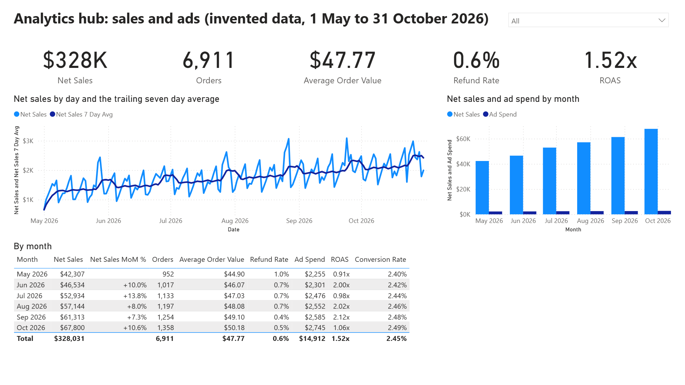
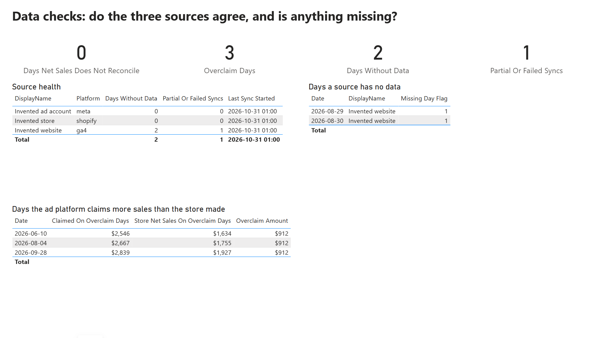

# Power BI report

The hub's data is stored as dated snapshots in Postgres. This folder reads the same tables in Power BI: a star schema, DAX measures, a Power Query load and two report pages. It is built on invented figures, so it can sit in a public repo and open on anyone's machine.

## Open it

| File | Use |
|---|---|
| `powerbi/AnalyticsHub.pbix` | Double click. The data is already inside it. Refresh reads the four CSV files from this repo's public address, so it needs only a connection (Power BI asks once for anonymous access). |
| `powerbi/AnalyticsHub.pbip` | The same report as text files: the model in TMDL, the report in PBIR. Opens in Desktop, diffs in git and reviews in a pull request. After opening, press Refresh once. |

To read the files from a clone instead of the web: Home > Transform data > Edit parameters, and set `DataFolder` to the full path of `powerbi/data/` ending in a backslash.

## Where the data comes from

`powerbi/export_data.py` loads three invented sources for one invented tenant (a store, an ad account and a website, 184 days, 1 May to 31 October 2026) through the hub's own migrations and its `upsert_snapshots` function, then reads them back from the tables as four CSV files. The figures are fixed formulas, so two runs give identical bytes. `python powerbi/export_data.py --check` compares the files on disk with the formulas and needs no database.

| File | Rows | What it holds |
|---|---|---|
| `fact_snapshot.csv` | 2,568 | one row per source, metric and day; money in cents with its currency |
| `dim_metric.csv` | 14 | key, label, unit, kind (copied from migrations 001, 006 and 007; a test compares them) |
| `dim_connection.csv` | 3 | the three sources |
| `sync_run.csv` | 21 | one run per source per 28 day window, one of them partial |

Four things are planted on purpose so the checks have something to find: the website sync missed 29 and 30 August (and its run says partial), the ad account double counted purchases on 10 June, 4 August and 28 September, and a few days carry refund spikes.

## The model

Five tables: `Snapshot` (the fact), `Date` (a DAX calendar marked as the date table), `Metric`, `Connection` and `SyncRun`, with four relationships, all one to many. Power Query reads each CSV with typed columns (`Csv.Document`, `Table.TransformColumnTypes`, a rename step) through one function, `GetFile`, that opens a file from disk or from a web address, so the same model works from a clone or from the public repo.

27 measures sit on `Snapshot` in display folders:

| Folder | Measures |
|---|---|
| Sales | Orders, Gross Sales, Refunds, Net Sales, Average Order Value, Refund Rate |
| Time intelligence | Net Sales Previous Month, Net Sales MoM %, Net Sales MTD, Net Sales 7 Day Avg |
| Ads | Ad Spend, Ad Purchases, Ad Purchase Value, ROAS, Cost per Purchase |
| Website | Sessions, Conversion Rate (counts only days the website has a figure for) |
| Checks | Net Sales Gap, Days Net Sales Does Not Reconcile, Overclaim Amount, Overclaim Days, Missing Day Flag, Days Without Data, Partial Or Failed Syncs, Last Sync Started |

Money is stored as integer cents, so the money measures divide by 100 once, in the measure, and the formats are dollars.

## What the checks page answers

Whether the three sources agree and whether anything is missing: gross minus refunds against the stored net sales (zero days differ), days the ad platform claims more sales than the store made (three, each $912 over), days a source has no data (two, both the website), and failed or partial sync runs (one).

## Checked by opening it

`python powerbi/check_model.py` opens a temporary copy of the .pbix in Power BI Desktop, runs the measures through the model's own Analysis Services port (`run_dax.ps1`) and compares each with a figure computed from the CSV files in plain Python: row counts of all five tables, 15 totals, four figures for each of the six months (net sales, orders, ad spend, month on month), the trailing average and month to date on the last day, the overclaim days and amounts, the missing days per source and the failed runs per source. Run on 15 November 2026, Power BI Desktop 2.159, Microsoft Store build: 56 of 56 comparisons match, and Desktop is closed again afterwards.

The same check against a copy of the data with one dollar added to one day fails six comparisons (the total, the gap, the reconcile count, that month and the two month on month figures after it), so it can fail. `tests/test_powerbi_project.py` runs without Desktop: the data files against their formulas, the migration labels, the model files against the CSV headers, every field in every visual against the model, the comparison against seven kinds of tampering, and the real export through Postgres.

What the first Desktop runs found, now fixed: the Source health total row said zero days without data beside a row that said two (a row context does not filter a table by itself, so the measure now loops over the sources and uses `CALCULATE`), the month on month figure on the total row compared the whole range with one month (it is now blank outside a month), and three cards showed blank where zero was the answer.

## Limits

Built against invented figures loaded through the hub's own tables. The source is four CSV files written from Postgres, and the report runs in Desktop. Publishing to the Power BI service is a separate step (Fabric needs a work or school account), and the model would not change for it.
